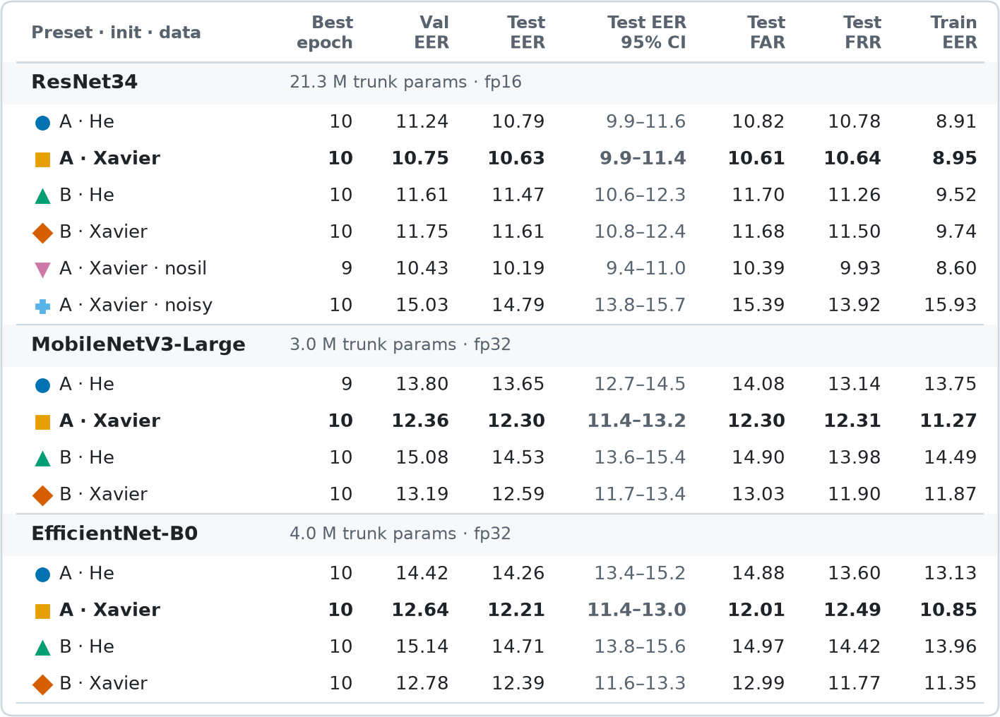
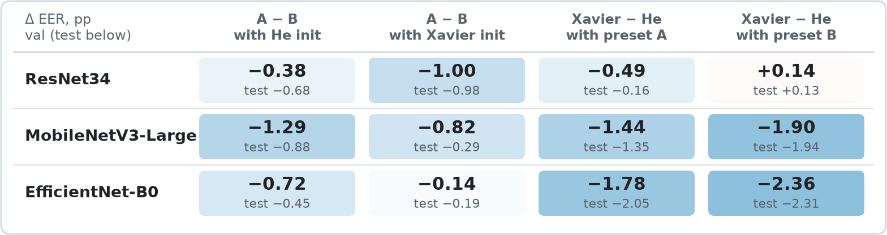
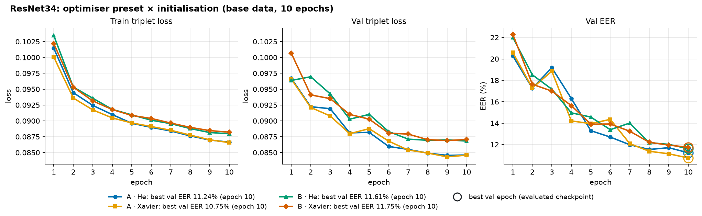
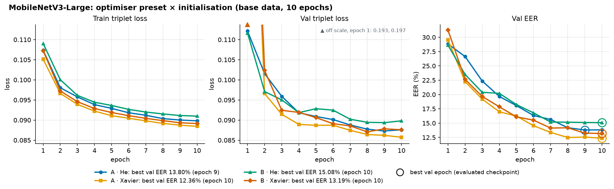
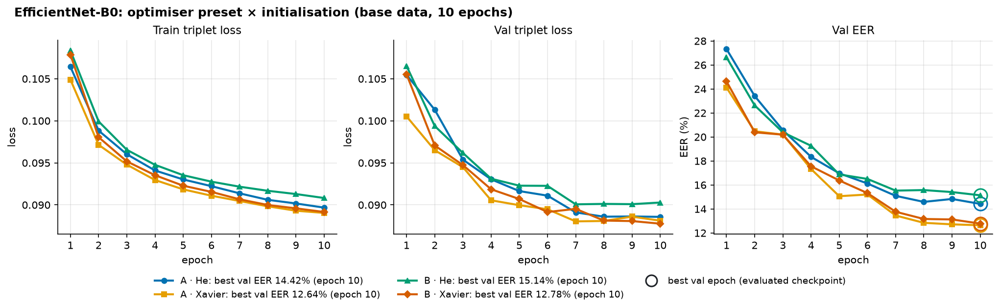
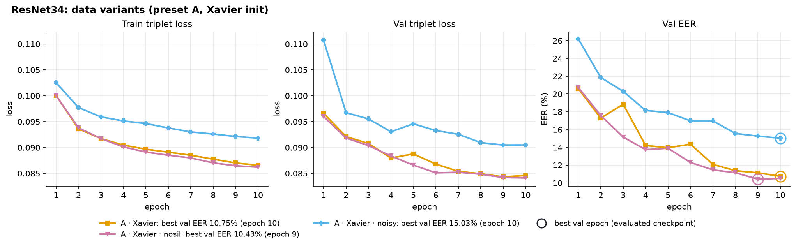

# Triplet-loss speaker embeddings: architectures and hyperparameters

> **Note: no reproduction code yet.** These runs use a different style of training from the
> shared `iml` pipeline (triplet-loss metric learning with its own training loop, not the binary
> classifier of `iml-train`). I also did not want to overload this report with helper code, so
> this folder holds only the write-up, the figures and the tables.

**Project:** IML voice intercom: speaker-embedding backbones trained from scratch  
**Runs:** `runs/glhfsox/triplet_backbones/` on the Coder workspace; MLflow experiment `glhfsox/triplet_backbones`  
**Status:** 14 finished runs, single seed; an exploratory grid, not a production-readiness assessment

## Objective

Compare three CNN backbones (ResNet34, MobileNetV3-Large, EfficientNet-B0) as speaker-embedding
models trained from scratch with a triplet loss. For each backbone, compare two optimiser presets
and two weight initialisations. For the best ResNet34 configuration, also compare two variants of
the training data. Every model is scored on speakers it never saw in training.

## Setup

- **Backbones:** torchvision ResNet34 (21.3 M trunk parameters), MobileNetV3-Large (3.0 M) and
  EfficientNet-B0 (4.0 M). All start from random weights. Each has a 1-channel stem, and every
  activation is ReLU (the squeeze-excitation gates keep their sigmoid). The embedding head is
  dropout, then linear, then batch norm, giving a 256-d L2-normalised embedding.
- **Optimiser presets** (each changes three settings at once):
  - **A:** AdamW, lr 1e-3, weight decay 0.05 (decoupled; not applied to batch-norm weights or
    biases), dropout 0.25 before the embedding.
  - **B:** Adam, lr 1e-3, no weight decay, dropout 0.5.
- **Initialisation:** He (`kaiming_normal_`, fan-in) or Xavier (`xavier_uniform_`) for the conv
  and linear weights. Batch norm starts at weight 1 and bias 0.
- **Loss:** triplet loss on cosine similarity, margin 0.2, with online semihard mining in every
  epoch. Each batch holds 128 clips: 32 speakers × 4 clips.
  - Why semihard only: an earlier 30-epoch ResNet34 run switched to hard mining at epoch 11, and
    its val EER rose from 11.05% to 23.3% within three epochs. The grid therefore stops at 10
    epochs, before that switch would happen.
- **Training:** 10 epochs of 64,000 clips each, about 5.2 passes over the train clips. Cosine
  learning-rate schedule with 2 warm-up epochs, gradient clipping at 5, seed 42.
  - Precision: ResNet34 trains in fp16. MobileNetV3 and EfficientNet train in fp32, because fp16
    was slower for both on this GPU and bf16 crashed EfficientNet.
- **Input:** 3 s clips as 80 log-mel bands × 300 frames, normalised per sample.
- **Data:** VoxCeleb1, VoxCeleb2 and TidyVoiceX, split by speaker. Val and test speakers are
  never seen in training.
  - Train: 2,747 speakers, 123,196 clips.
  - Val: 347 speakers, 10,663 clips, 34,611 trials.
  - Test: 345 speakers, 10,508 clips, 34,369 trials.
- **Data variants** (ResNet34, preset A, Xavier init):
  - **base:** loudness-normalised speech with the ends trimmed; each clip is at least 60% speech.
  - **nosil:** every non-speech stretch longer than 200 ms is removed, in train, val and test.
  - **noisy:** train clips get MUSAN, DEMAND, babble and coloured noise at 5–20 dB SNR, plus
    reverb on 30% of clips and a ±1 semitone pitch shift on 50%. Val and test are the clean base
    clips.
- **Evaluation:**
  - Checkpoint: the epoch with the lowest val EER.
  - Decision threshold: the val EER point, applied unchanged to test. This is why test FAR and
    FRR come out close to each other.
  - Test EER confidence interval: 95% speaker bootstrap (1,000 resamples).
  - Train EER: measured on 400 train speakers with the same trial protocol.
- **Hardware:** AMD Radeon 8060S (ROCm 7.2, PyTorch through its CUDA-compatible HIP interface).

## Results

All rates are in %. In bold: the base run with the lowest **val** EER for each backbone. The
selection uses val only; test is reported, never selected on. Each group header gives the
backbone's trunk size and training precision.

The 95% CI is how far the test EER could move with a different set of test speakers. The test
speakers were resampled with replacement 1,000 times and the EER recomputed each time; the CI is
the 2.5th to 97.5th percentile of those values. When two runs' intervals overlap a lot, the
difference between them is not reliable.

### Effect of the optimiser preset and the initialisation

Each cell compares two base runs that differ in one factor only; the other factor is held fixed
as named in the column. The large number is the val EER difference and the small one the test
EER difference, both in percentage points. Negative (blue) means preset A, or Xavier init, has
the lower EER.

### Learning curves: one figure per backbone

The rings mark the evaluated checkpoint (the best val epoch). Both loss panels of a figure share
one y range.

#### ResNet34

#### MobileNetV3-Large

With Xavier init, both presets start at a val loss of 0.19–0.20 in epoch 1, roughly twice the
other runs. This drops into the normal range by epoch 2, and their epoch-1 val EER is not unusual.

#### EfficientNet-B0

#### ResNet34: data variants

The noisy run's train loss and train EER are measured on augmented clips. Its val curves use the
clean base clips.

## Observations

1. **ResNet34 is the best backbone.** Its best configuration (preset A, Xavier) reaches val EER
   10.75% and test EER 10.63% [95% CI 9.9–11.4], with FAR 10.61% and FRR 10.64%. The best
   MobileNetV3 (12.30% [11.4–13.2]) and EfficientNet (12.21% [11.4–13.0]) are about 1.6 pp worse
   on test, and their intervals only touch ResNet34's at the edge. This is the largest difference
   in the grid.
2. **MobileNetV3-Large and EfficientNet-B0 tie at their best:** test EER 12.30% vs 12.21%.
   MobileNetV3 has the fewer parameters (3.0 M vs 4.0 M).
3. **Preset A beats preset B in all six pairs.** Val EER is lower by 0.14 to 1.29 pp, and test
   EER moves the same way in every pair. Because A and B differ in optimiser, weight decay and
   dropout at once, this grid cannot say which of the three is responsible.
4. **Xavier beats He in five of six pairs.** The effect is large for the two compact backbones
   (val EER lower by 1.44 to 2.36 pp) and small for ResNet34 (−0.49 pp with preset A, +0.14 pp
   with preset B). Hyperparameters move the compact backbones much more: the range of val EER
   across the four configurations is 2.7 pp for MobileNetV3, 2.5 pp for EfficientNet and 1.0 pp
   for ResNet34.
5. **No overfitting within 10 epochs.** Train and val loss fall together. For the selected runs,
   train EER is only 1.1 to 1.8 pp below val EER (ResNet34: 8.95% vs 10.75%).
6. **The models are still improving.** In 12 of the 14 runs, the best val epoch is the last one,
   and val EER is still falling at epoch 10.
7. **Data variants (ResNet34):**
   - Removing silence (nosil) gives the lowest numbers of all runs: val 10.43%, test 10.19%
     [9.4–11.0]. The interval overlaps base's, and nosil is scored on silence-removed val and
     test clips, so this is not a measured improvement.
   - Noise, reverb and pitch augmentation (noisy) is clearly worse within this budget: val
     15.03%, test 14.79%, about 4.2 pp above base on the same clean clips.

## Interpretation and limitations

- Each configuration was trained once, with seed 42. The CIs come from bootstrapping test
  speakers and do not include run-to-run variation. Paired differences below about 1 pp
  (most cells in the effects table) should not be read as reliable.
- With 10 epochs and the best epoch mostly the last, the ranking reflects a short training budget.
  It may change once the runs train to convergence. This applies especially to the noisy
  variant, whose val EER was still falling.
- Data variants exist only for ResNet34. The MobileNetV3 nosil run was interrupted at epoch 3 and
  is left out; the EfficientNet variants were not run.
- All numbers come from VoxCeleb and TidyVoiceX speakers. They do not measure accuracy on our own
  team recordings, which is what the intercom actually sees. This grid also includes no pretrained
  reference, such as the WeSpeaker ResNet34 the app uses, scored on the same trials.
- The test FAR is about 10% even for the best run. These are research-stage error rates, not
  evidence for access-control deployment.

## Where the numbers come from

Each run folder in `runs/glhfsox/triplet_backbones/<variant>_<backbone>_<A|B>_<he|xavier>_4406c8/`
holds `final.json` (every metric in this report), `history.csv` (the curves), `report.md`, and
per-run plots (DET/ROC, score histograms, t-SNE, per-slice EER). The same runs are logged to the
MLflow experiment `glhfsox/triplet_backbones`. The figures and tables in this folder were drawn
from these run folders.
