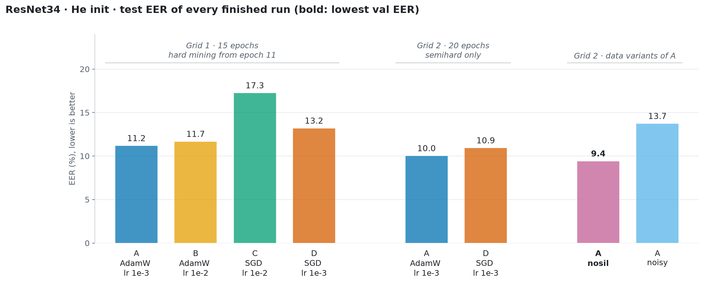
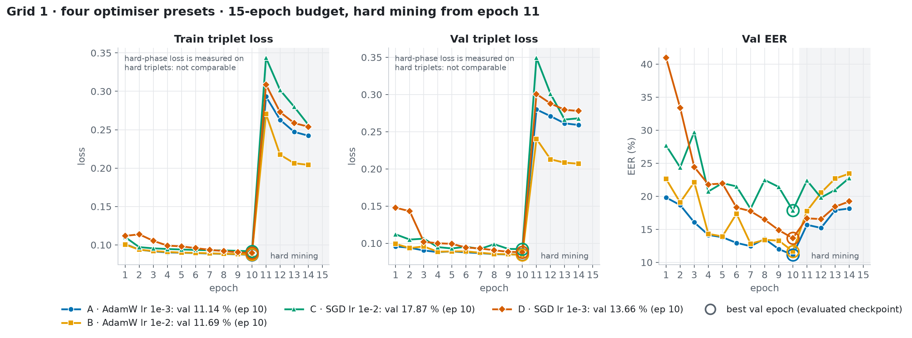
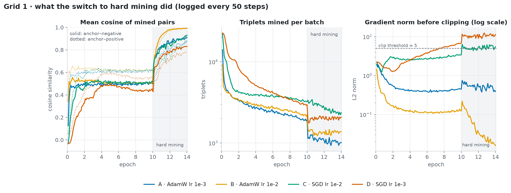
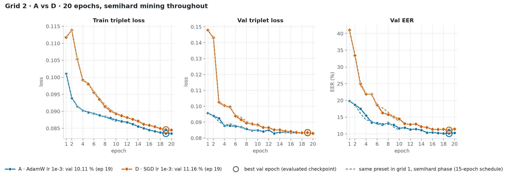
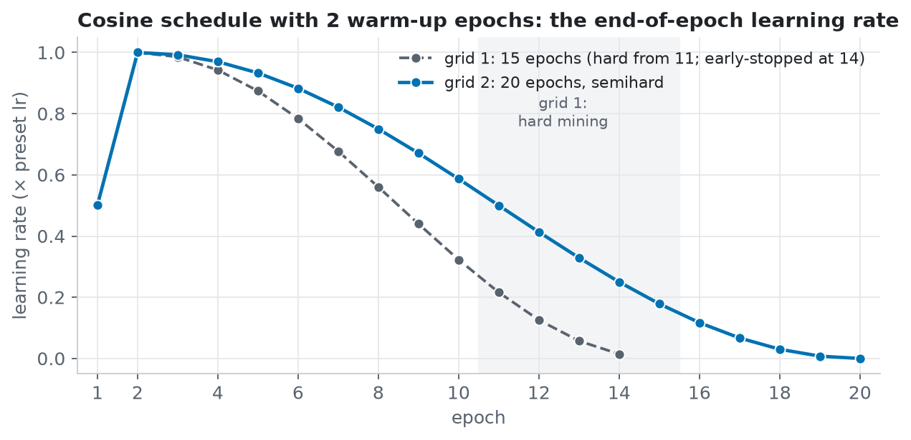
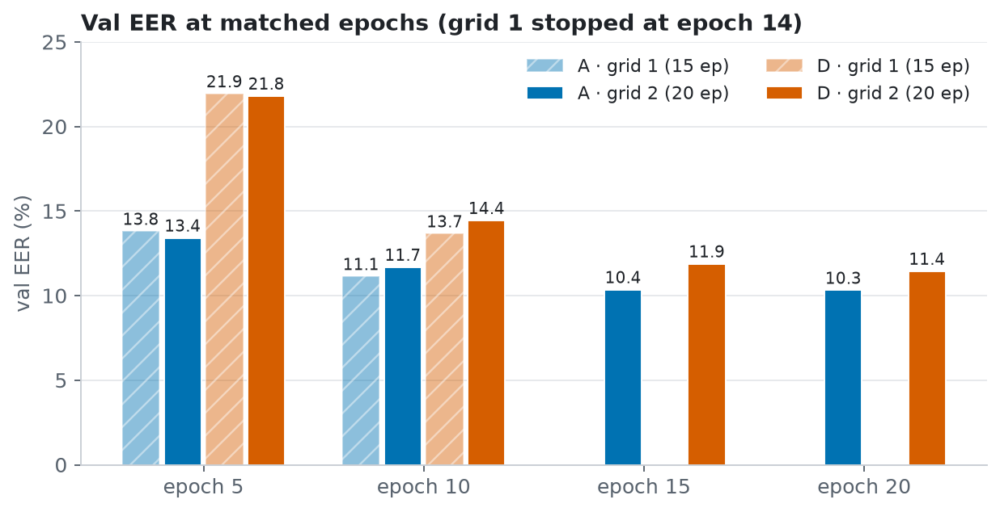
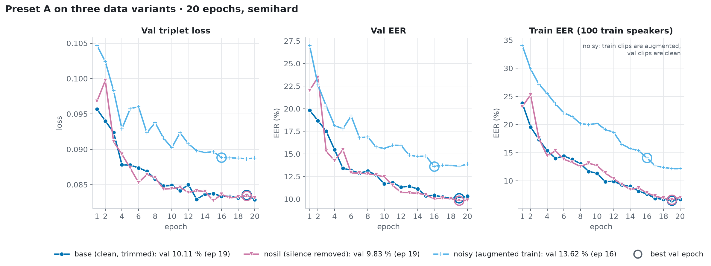

# Triplet-loss speaker embeddings: optimiser presets, mining schedule and training budget

> **Note: no reproduction code in this folder.** The runs come from the `sv_metric` notebook
> (`notebooks/glhfsox/sv_metric/training.ipynb`) and its training package, not from the shared
> `iml-train` classifier pipeline. This folder holds only the write-up and the figures.

**Project:** IML voice intercom: speaker-embedding backbones trained from scratch  
**Runs:** `runs/glhfsox/triplet_backbones/` on the Coder workspace; MLflow experiment `glhfsox/triplet_backbones`  
**Status:** 8 finished runs in two grids, single seed; a hyperparameter study, not a production-readiness assessment

## Objective

The [architecture report](../arch/README.md) picked ResNet34 and compared only two optimiser
presets that changed three settings at once. This report isolates the optimiser: four presets on
one backbone (ResNet34, He init), with the same nominal weight decay and dropout everywhere, so
the presets differ in the optimiser family and the learning rate (and, as a consequence, in how
the weight decay acts; see Limitations). The first grid also revealed what a
switch to hard triplet mining does to this model, so the second grid drops it and trains longer.
For the best preset, the two training-data variants are repeated under the new schedule.

## Setup

- **Backbone:** torchvision ResNet34 (21.3 M trunk parameters), random init with He
  (`kaiming_normal_`, fan-in) for conv and linear weights. 1-channel stem, ReLU everywhere. Head:
  dropout 0.2, linear, batch norm; 256-d L2-normalised embedding. fp16 autocast.
- **Optimiser presets** (weight decay 0.05 and dropout 0.2 in every preset; decay is not applied
  to batch-norm weights or biases):
  - **A:** AdamW, lr 1e-3
  - **B:** AdamW, lr 1e-2
  - **C:** SGD, momentum 0.9, lr 1e-2
  - **D:** SGD, momentum 0.9, lr 1e-3
  
  Preset A is the preset A of the architecture report with dropout 0.25 lowered to 0.2. For AdamW
  the decay is decoupled; for SGD PyTorch adds it to the gradient (coupled L2), where momentum
  amplifies it about 10×.
- **Loss:** triplet loss on cosine similarity, margin 0.2, with online mining. Each batch holds
  128 clips: 32 speakers × 4 clips. Gradient clipping at 5, seed 42.
- **Two grids, two schedules.** Both use a cosine learning-rate schedule with 2 warm-up epochs
  and 64,000 clips per epoch (about 0.52 passes over the train clips).
  - **Grid 1:** presets A–D, 15 epochs, semihard mining for epochs 1–10 and **hard** mining from
    epoch 11. Early stopping with patience 4 after epoch 12.
  - **Grid 2:** presets A and D, 20 epochs, **semihard** mining throughout, no early stopping.
    Preset B was dropped because it tied with A at a 10× larger learning rate; C was the worst
    run of grid 1 by a wide margin.
- **Input:** 3 s clips as 80 log-mel bands × 300 frames, normalised per sample.
- **Data:** VoxCeleb1, VoxCeleb2 and TidyVoiceX, split by speaker. Val and test speakers are
  never seen in training.
  - Train: 2,747 speakers, 123,196 clips (nosil: 133,170, since removing silence re-cuts the
    recordings into more 3 s clips).
  - Val: 347 speakers, 10,663 clips, 34,611 trials.
  - Test: 345 speakers, 10,508 clips, 34,369 trials.
- **Data variants** (grid 2 schedule, preset A):
  - **base:** loudness-normalised speech with the ends trimmed; each clip is at least 60% speech.
  - **nosil:** every non-speech stretch longer than 200 ms is removed, in train, val and test.
  - **noisy:** train clips get MUSAN, DEMAND, babble and coloured noise at 5–20 dB SNR, plus
    reverb on 30% of clips and a ±1 semitone pitch shift on 50%. Val and test are the clean base
    clips.
- **Evaluation:** as in the architecture report. Checkpoint = lowest val EER epoch; decision
  threshold = the val EER point applied unchanged to test; train EER on 400 train speakers with
  the same trial protocol.
- **Hardware:** AMD Radeon 8060S (ROCm 7.2). One grid-1 run takes 27 min, one grid-2 run 39 min.

## Results

In bold: the run with the lowest val EER of the study. The selection uses val only; test is
reported, never selected on.

All rates in %. FAR and FRR are on test at the val-EER threshold. Train EER is on 400 train
speakers.

| Grid | Run | Best epoch | Val EER | Test EER | Test FAR | Test FRR | Train EER |
|---|---|---:|---:|---:|---:|---:|---:|
| 1 · 15 ep, hard from 11 | A · AdamW lr 1e-3 | 10 | 11.14 | 11.19 | 11.24 | 11.15 | 9.77 |
| | B · AdamW lr 1e-2 | 10 | 11.69 | 11.68 | 11.68 | 11.69 | 11.03 |
| | C · SGD lr 1e-2 | 10 | 17.87 | 17.26 | 18.05 | 16.42 | 19.92 |
| | D · SGD lr 1e-3 | 10 | 13.66 | 13.21 | 13.51 | 12.85 | 13.59 |
| 2 · 20 ep, semihard | A · AdamW lr 1e-3 | 19 | 10.11 | 10.04 | 10.14 | 9.90 | 5.71 |
| | D · SGD lr 1e-3 | 19 | 11.16 | 10.94 | 10.92 | 11.01 | 7.55 |
| 2 · variants of A | **A · nosil** | **19** | **9.83** | **9.43** | **9.59** | **9.33** | **5.81** |
| | A · noisy | 16 | 13.62 | 13.74 | 14.39 | 12.86 | 11.98 |

### Grid 1: four presets under the hard-mining schedule

The rings mark the evaluated checkpoint. All four runs peak at epoch 10, the last semihard
epoch, and early stopping ends them at epoch 14. The loss in the hard phase is computed on hard
triplets only and is not comparable to the semihard phase.

### What the switch to hard mining did

Logged every 50 steps during training. The left panel shows the mean cosine similarity of the
anchor–negative pairs (solid) and anchor–positive pairs (dotted) that the miner selected.

### Grid 2: A vs D, 20 semihard epochs

The dashed lines are the same presets in grid 1 during their semihard phase. In epochs 1–10
both grids mine semihard, so the only difference there is the length of the cosine schedule;
the matched-epoch val EER differs by up to 1.5 pp in either direction and by 0.6–0.8 pp at
epoch 10.

Both schedules warm up for 2 epochs and decay to zero at their last epoch. At epoch 10 the
15-epoch schedule is at 0.32× the preset learning rate, the 20-epoch one at 0.59×.

Val EER at matched epochs. Grid 1 stopped at epoch 14, so it has no epoch-15 or epoch-20 bar.

### Preset A on three data variants

The noisy run's train EER is measured on augmented clips; its val curves use the clean base
clips.

## Observations

1. **AdamW beats SGD at every checkpoint and throughout the semihard epochs.** In grid 1, A is
   2.5 pp below D on val EER (11.14% vs 13.66%) and B is 6.2 pp below C (11.69% vs 17.87%). In
   grid 2, A stays ahead of D by 1.1 pp on val (10.11% vs 11.16%) and 0.9 pp on test (10.04% vs
   10.94%), a gap that is small enough to need a second seed. SGD also starts much worse: D's val
   EER is 41% after epoch 1 against 20% for A and needs 11 epochs to get within 2 pp of A.
2. **lr 1e-2 is unstable for both optimisers; SGD suffers more from it.** B (AdamW, 1e-2) ends
   about 0.5 pp behind A at the checkpoint, but its val EER swings by 3–8 pp between epochs
   (19.1 → 22.2 → 14.3%), its train EER is higher than A's (11.03% vs 9.77%) and it degrades more
   under hard mining. C (SGD, 1e-2) is the worst run of the study, with swings of up to 9 pp. D
   (SGD, 1e-3) is the SGD run whose gradient norm passes the clip threshold: 5 at epoch 8, 6.5 at
   epoch 10, so from epoch 8 on it effectively trains with normalised gradients. The lower rate
   is the right one for both optimisers.
3. **Hard mining collapses the embedding; it does not explode the gradients.** After the switch,
   the mean cosine of the mined negatives rises within one epoch from about 0.5 to 0.74 (D)
   through 0.93 (B), and the mined positives rise with them; by epoch 14 B's negatives and
   positives both sit at 0.99: every embedding has moved toward every other. The hard-triplet
   loss (which is at least the margin for every mined triplet by construction) settles at the
   margin itself, 0.20 for B, which is what a collapsed space produces. Val EER rises from 11.1%
   to 18.2% (A) and from 11.7% to 23.4% (B) by epoch 14. Gradient norms do not explode: A stays
   at 0.4–0.7, B falls from 0.12 to 0.02 (another sign that the embeddings stopped moving), C
   goes from 3.3 to about 5 and D from 6.5 to about 10, both clipped. Semihard mining, which
   only uses triplets where the negative is already farther than the positive, never produced
   this behaviour in any run.
4. **Removing the hard phase and training longer is worth 1–2.5 pp.** Preset A goes from
   11.14% / 11.19% (val / test, grid 1) to 10.11% / 10.04% (grid 2); D from 13.66% / 13.21% to
   11.16% / 10.94%. The longer schedule is slightly behind at epoch 10 (A: 11.68% vs 11.14%) and
   overtakes during epochs 11–20, which it runs at a higher learning rate than grid 1 ever had
   after epoch 10. More epochs and a slower decay are one change here; the grid does not
   separate them.
5. **The gains stop before epoch 20.** For A, val EER drops 1.3 pp over epochs 11–15 (11.68% →
   10.36%) and then stays flat: 10.42, 10.24, 10.12, 10.11, 10.32% over epochs 16–20. The best
   epoch is 19 in three of the four grid-2 runs, but the learning rate is near zero there, so
   with a cosine schedule that is the expected place for the minimum, not evidence that a longer
   run would keep improving. A longer budget is a hypothesis to test, not a conclusion of this
   grid.
6. **The train–val gap has opened.** In the architecture report (10 epochs) train EER was 1.1 to
   1.8 pp below val. At 20 epochs the gap for A is 4.4 pp (train 5.71% vs val 10.11%) and for
   D 3.6 pp. Val loss is flat from epoch 15 on while train loss still falls. If longer runs are
   tried, they will need stronger regularisation or augmentation to keep paying off.
7. **Data variants (preset A, 20 epochs):**
   - **nosil** gives the lowest numbers of the study: val 9.83%, test 9.43%, 0.3 pp (val) and
     0.6 pp (test) below base. As in the architecture report, nosil is scored on silence-removed
     val and test clips, so this is not a like-for-like improvement, only not a regression.
   - **noisy** is 3.5 pp above base on val (13.62%) and 3.7 pp on test (13.74%); at epoch 10 the
     val gap was 3.9 pp, so the extra epochs did not close it. Its curve flattens over the last
     epochs like the clean runs do. Its train EER (11.98%) is close to its val EER, the opposite
     of the clean runs, which is what a model that cannot fit the augmented clips looks like.
     Milder augmentation (higher SNR floor, lower reverb and pitch-shift rates) or applying it to
     only part of each batch is the thing to try next.

## Interpretation and limitations

- Each configuration was trained once, with seed 42, so run-to-run variation is unknown.
  Differences of about 1 pp (A vs B in grid 1, A vs D in grid 2, nosil vs base) should not be
  read as reliable. The grid-1 AdamW-vs-SGD gaps (2.5 and 6.2 pp) and the hard-mining effect
  (7–12 pp) are several times larger.
- **The SGD presets do not get the same regularisation as the AdamW ones.** With PyTorch's SGD
  the weight decay of 0.05 is coupled L2, added to the gradient and amplified by momentum; per
  step it shrinks the weights by roughly lr × 0.05 / (1 − 0.9), ten times what AdamW's decoupled
  decay does at the same learning rate, and 0.05 is far above the values SGD is normally run
  with. D's gradients are also clipped from epoch 8 on. A tuned SGD (weight decay around 1e-4
  first, then lr, warm-up and momentum) might close part of the gap. This grid says AdamW is the
  safer default under a shared setting, not that SGD cannot work.
- Grid 1 and grid 2 differ in two things at once: the mining schedule and the epoch budget.
  Epochs 1–10 are semihard in both and differ only in schedule length (matched-epoch val EER
  within 1.5 pp); no run combines a hard phase with the 20-epoch budget, so the two effects are
  not separated.
- All numbers come from VoxCeleb and TidyVoiceX speakers. They do not measure accuracy on our own
  team recordings, which is what the intercom actually sees. The pretrained WeSpeaker ResNet34
  reference on the same trials was not computed for this grid.
- The test FAR is about 10% even for the best run. These are research-stage error rates, not
  evidence for access-control deployment.

## Where the numbers come from

Grid 1 run folders are archived under
`runs/glhfsox/triplet_backbones/_grid15_hard/<variant>_resnet34_<A|B|C|D>_he_8de047/`, grid 2 and
the data variants under `runs/glhfsox/triplet_backbones/<variant>_resnet34_<A|D>_he_b0b9c5/`. The
six-character suffix is a hash of the training fields that differ from the code defaults, so the
two grids never share a folder. Each folder holds `final.json` (every metric in
this report), `history.csv` (the epoch curves), `steps.csv` (the mining statistics, every 50
steps), `report.md` and per-run plots (DET/ROC, score histograms, t-SNE, per-slice EER). The
same runs are logged to the MLflow experiment `glhfsox/triplet_backbones`. A grid-1 nosil run
trained all 14 epochs but was killed by the container's memory limit during its final evaluation
and is left out.
