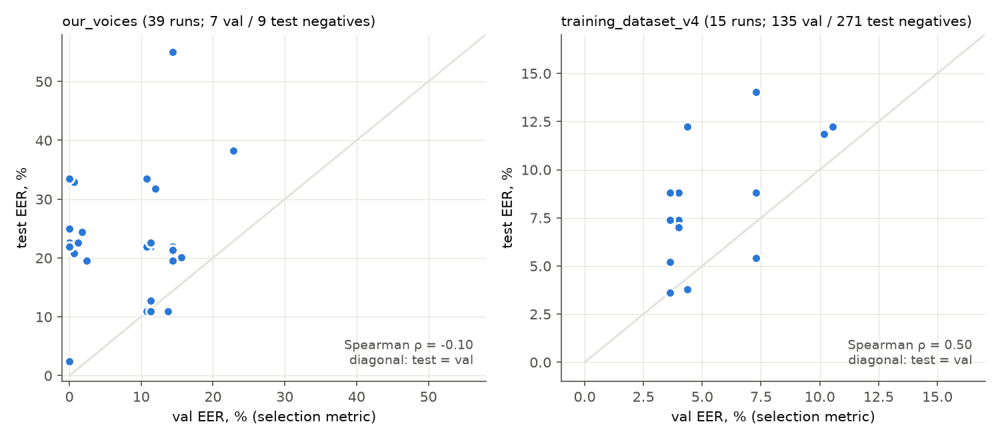
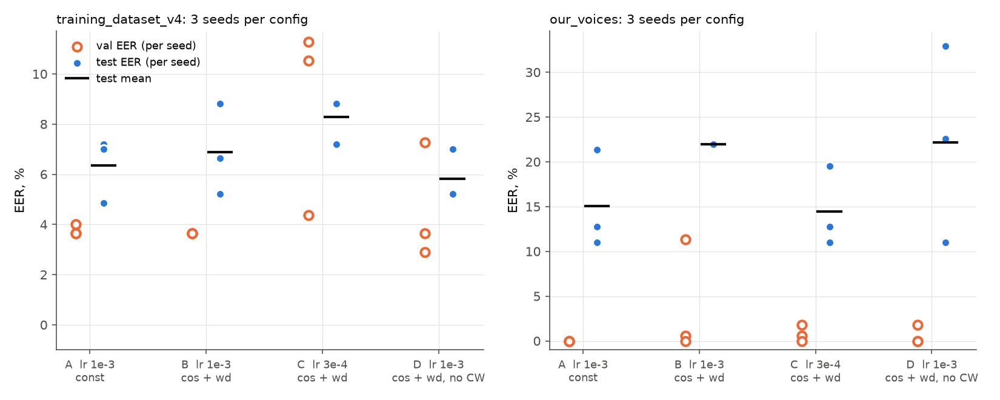
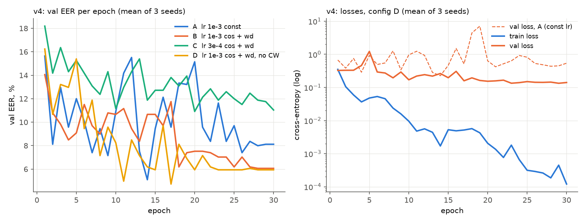

# RegNet-Y-800MF fine-tuning experiments

## Objective

1. Find the RegNet hyperparameters that work best.
2. Check whether the best setup is different on the two datasets that were used.
3. Pick a configuration that generalizes rather than one that got lucky on val. RegNet fits the train
   split perfectly in every run, so this is the main concern.

## Setup

- ImageNet-pretrained RegNet-Y-800MF with a 1-channel stem. All layers are fine-tuned.
  The dropout is applied before the classifier.
- Shared `fit()` loop. The kept checkpoint is the epoch with the **lowest val EER**. The decision
  threshold is the val FAR = FRR point, and it is applied unchanged to train and test.
- 30 epochs (some early runs used 20), batch size 32 unless stated, AMP, seed 42 unless stated.
  AdamW for every run except a few early Adam runs.

### Datasets

|                     | train (neg / pos) | val (neg / pos) | test (neg / pos) | train imbalance ratio | negative speakers |
|---------------------|-------------------|-----------------|------------------|----------------------:|-------------------|
| `training_dataset_v4` | 949 / 199       | 135 / 28        | 271 / 57         | 4.8 (neg majority)    | T + about 240 external (VoxCeleb1) speakers |
| `our_voices`        | 56 / 591          | 7 / 83          | 9 / 83           | 10.6 (pos majority)   | **T only**        |

`our_voices` has two problems as a benchmark:

- **One negative speaker.** The model learns "reject T", not "reject strangers". Test FAR measures
  only T.
- **7 val and 9 test negatives.** One clip moves val FAR by 14.3 pp and test FAR by 11.1 pp. Val EER is
  0% in 10 of the 39 grid runs, so val cannot rank configurations.

The README also notes that `our_voices` is not the unified training source. `v4` is the larger
dataset, with 1,148 train and 1,639 total clips against 829.

## 1. Single-seed grid (`runs/dnlvtk/regnet/`)

The grid had 39 runs on `our_voices` and 15 on `v4`. It varied the learning rate (1e-4, 3e-4, 1e-3,
5e-2), dropout (0, 0.1, 0.2, 0.3), class weighting, scheduler (none, step, cosine), loss (CE, focal),
batch size (32, 64) and pretraining. On `v4` the learning rates were 1.1e-3 and 3.1e-4. The extra
trailing 1 only gives the runs new folder names; they are effectively 1e-3 and 3e-4.

Each dot is one run, and the diagonal is test EER equal to val EER.

- **On `our_voices`, val EER does not predict test EER** (Spearman ρ = −0.10). Runs with 0% val EER
  reach anywhere from 2% to 33% test EER. Model selection on this dataset is not meaningful.
- **On `v4`, the relationship is moderate** (ρ = 0.50). Every run sits above the diagonal: test EER is
  1 to 8 pp worse than the selected val EER.

Mean over the grid runs at each learning rate (min–max in brackets):

| dataset    | lr            | runs | val EER %        | test EER %        | test FAR %        | train EER % |
|------------|---------------|-----:|------------------|-------------------|-------------------|------------:|
| our_voices | 1e-4          | 4    | 12.9 [11.4–14.4] | 22.0 [21.4–22.6]  | 33.3              | 0.0 |
| our_voices | 3e-4          | 14   | 5.1 [0.6–14.4]   | 20.0 [11.0–24.4]  | 46.8 [11.1–77.8]  | 3.1 |
| our_voices | 1e-3          | 14   | 2.9 [0.0–14.4]   | 22.3 [2.4–33.5]   | 43.7 [0.0–77.8]   | 0.3 |
| our_voices | 5e-2          | 7    | 13.8 [10.8–22.8] | 29.1 [12.8–55.0]  | 46.0 [22.2–100]   | 20.0 |
| v4         | 3e-4 (3.1e-4) | 6    | 7.8 [4.4–10.5]   | 10.8 [5.4–14.0]   | 7.9               | 0.3 |
| v4         | 1e-3 (1.1e-3) | 9    | 3.8 [3.6–4.4]    | 6.8 [3.6–8.8]     | 5.9               | 0.1 |

- **lr 5e-2 is too high.** It is the only setting that fails to fit train (train EER 20%) and the worst on
  test. Learning rates of 1e-3 and 3e-4 are about equal on `our_voices`, while on `v4` 1e-3 is clearly
  better.
- **The best single `v4` run was 7a3418:** lr 1.1e-3, dropout 0.3, balanced class weights, test EER
  3.6%. It does not reproduce (see section 2).
- **Batch size 64 was not better on `v4`.** The six bs-64 runs average 9.4% test EER against 7.6% for
  the matching bs-32 runs.
- **Focal loss did not help on `v4`.** The two focal runs reached 7.4% and 7.0% test EER, within the CE
  range.

## 2. Seed check: 4 configs × 3 seeds × 2 datasets

Reproduce with [`seeds_datasets.ipynb`](../../notebooks/dnlvtk/regnet/seeds_datasets.ipynb).
All four configs share pretrained=true, AdamW, 30 epochs, dropout 0.3 and batch size 32. The seeds are
42, 7 and 123.

| config | lr   | scheduler | weight decay | class weight |
|--------|------|-----------|-------------:|--------------|
| A      | 1e-3 | none      | 0            | balanced (the grid winner on `v4`) |
| B      | 1e-3 | cosine    | 0.05         | balanced     |
| C      | 3e-4 | cosine    | 0.05         | balanced     |
| D      | 1e-3 | cosine    | 0.05         | none         |

Mean ± std over the 3 seeds, in %. "Val EER, last 10 ep." is the mean val EER over epochs 21–30. It
uses no test data, and it shows whether the val score holds up or was one lucky epoch.

| dataset    | config | val EER   | val EER, last 10 ep. | test EER       | test FAR       | test FRR      | test macro-F1 | train EER |
|------------|--------|-----------|---------------------:|----------------|----------------|---------------|--------------:|----------:|
| v4         | A      | 3.8 ± 0.2 | 8.8 ± 1.9            | 6.4 ± 1.3      | 5.9 ± 1.3      | 7.6 ± 1.0     | 90.0 ± 1.8    | 0.0 |
| v4         | B      | 3.6 ± 0.0 | 6.7 ± 3.4            | 6.9 ± 1.8      | 5.9 ± 0.7      | 7.0 ± 1.8     | 90.2 ± 0.8    | 0.2 |
| v4         | C      | 8.7 ± 3.8 | 12.0 ± 2.6           | 8.3 ± 0.9      | 8.6 ± 1.9      | 9.4 ± 2.7     | 86.4 ± 1.8    | 0.0 |
| v4         | **D**  | 4.6 ± 2.3 | **6.1 ± 1.7**        | **5.8 ± 1.0**  | 5.9 ± 0.4      | 5.3 ± 1.8     | 90.7 ± 0.8    | 0.0 |
| our_voices | A      | 0.0 ± 0.0 | 4.7 ± 4.2            | 15.0 ± 5.5     | 63.0 ± 17.0    | 4.0 ± 0.7     | 68.0 ± 7.0    | 1.3 |
| our_voices | B      | 4.0 ± 6.4 | 4.9 ± 6.6            | 22.0 ± 0.0     | 40.7 ± 23.1    | 6.8 ± 6.1     | 73.5 ± 3.6    | 0.0 |
| our_voices | C      | 0.8 ± 0.9 | 8.3 ± 6.8            | 14.4 ± 4.5     | 74.1 ± 17.0    | 5.2 ± 1.4     | 61.5 ± 10.1   | 0.0 |
| our_voices | D      | 0.6 ± 1.0 | 9.2 ± 6.7            | 22.2 ± 11.0    | 37.0 ± 6.4     | 5.6 ± 2.5     | 77.0 ± 2.7    | 0.0 |

## Findings

### The grid winner was mostly luck

Config A at seed 42 differs from grid run 7a3418 only in lr (1e-3 against 1.1e-3). Its test EER is
7.2% against 3.6%, and across 3 seeds A gives 4.8–7.2%.

At a constant lr of 1e-3, val EER on `v4` jumps between about 5% and 36% from one epoch to the next.
The selection rule takes the minimum over 30 epochs, so the reported val EER is optimistic, and the
test EER is 1–8 pp higher.

### Overfitting

RegNet memorizes the train split in every run: train EER is 0–0.5% and train loss reaches about 1e-4.
The question is whether val and test hold up as it does.

- **Constant lr (A):** val loss is noisy, spikes above 1 several times, and ends higher than it started.
  Late-epoch val EER is 8.8%.
- **Cosine schedule with weight decay 0.05 (B, D):** late-epoch val EER drops to 6.1–6.7%, close to the
  selected checkpoint's test EER (5.8–6.9%).
- **Config D's val loss:** it settles at about 0.14 (0.09–0.20 over seeds, epochs 21–30) and stays flat
  while train loss keeps falling. This is a stable plateau, not a rising curve.
- **Config B's val loss:** it ends at 0.24–0.63, between D and A (0.35–0.81). B and A also use
  class-weighted CE, so their loss values are not fully comparable with D's.
- **Why the plateau matters:** with B and D the selected checkpoint and the last epoch perform about the
  same, so the result depends far less on a lucky epoch.

The train–test gap of about 6 pp on `v4` is the real generalization gap. Dropout 0.1–0.3, focal loss
and batch size 64 did not close it in the grid.

### Best setup on `v4`: config D

Config D is pretrained RegNet-Y-800MF trained with AdamW, lr 1e-3, a cosine schedule over 30
epochs, weight decay 0.05, dropout 0.3, batch size 32, plain CE and no class weighting.

| metric (mean ± std, 3 seeds) | value     |
|------------------------------|-----------|
| test EER                     | 5.8 ± 1.0% |
| test FAR                     | 5.9 ± 0.4% |
| test FRR                     | 5.3 ± 1.8% |
| test macro-F1                | 90.7 ± 0.8% |

- **D was chosen on val stability, not on test.** It has the lowest late-epoch val EER (6.1 ± 1.7%), a
  flat val loss, and FAR and FRR close to each other.
- **D, A and B cannot be separated on test.** Their means are 5.8, 6.4 and 6.9% with std 1.0–1.8 pp,
  so the claim is that D is the most stable, not the most accurate.
- **lr 3e-4 (C) is worse** on every `v4` metric.
- **Class weighting is unnecessary on `v4`:** at a 4.8:1 ratio, D (no weighting) is at least as good as
  B (balanced weights).

The checkpoint to freeze is the D seed with the lowest **val** EER: seed 123, run `771cc3`
(val EER 2.9%, test EER 7.0%, FAR 6.3%, FRR 7.0%). Picking seed 42 or 7 because their test EER is
5.2% would be selecting on test.

### Does the best setup depend on the dataset?

- **Learning rate: the same on both.** About 1e-3 with AdamW works on both datasets. 3e-4 is equal on
  `our_voices` and worse on `v4`, and 5e-2 fails on both.
- **Everything else: `our_voices` cannot answer it.**
  - Val EER is 0–4% for every config, so it cannot rank them.
  - Test EER varies by up to 22 pp between seeds of the same config (D: 11.0–32.9%). That is larger
    than any difference between configs.
  - At the val threshold, test FAR is 37–74%: the model accepts T on most test clips. A threshold
    chosen on 7 negatives does not transfer.
  - The grid's best `our_voices` run (test EER 2.4%, cosine, dropout 0.2) had 67% test FAR at that
    threshold.
- **Training from scratch:** in the grid, the four `pretrained=false` runs on `our_voices` had a lower
  mean test EER (18.5%) than the pretrained runs (23.1%). Given the noise above, this is not evidence
  that pretraining hurts.

## Limitations

- **Three seeds per config.** The std values are rough. Differences smaller than about 2 pp on `v4` are
  not reliable.
- **v4 negatives are mostly VoxCeleb speakers,** a different channel from our recordings. Rejecting them
  is easier than rejecting a teammate who is not enrolled, and only T covers that case.
- **The seed check fixed dropout at 0.3 and batch size at 32.** Two-phase fine-tuning (README rules) and
  augmentation were not tried. `cfg.augment` is unused by the current loader.
