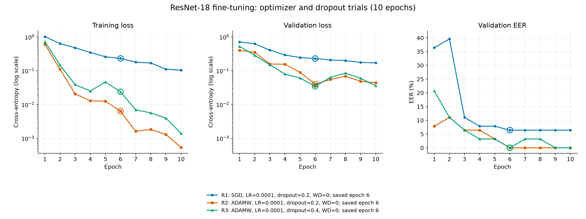
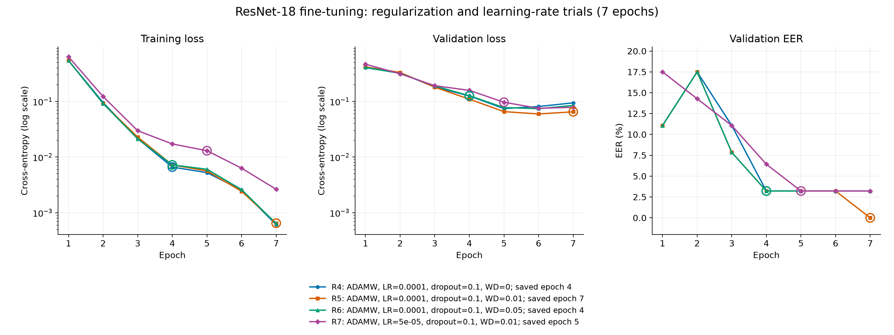

# ResNet-18 fine-tuning experiments

I tested optimizers, dropout, weight decay and learning rate on the fixed `training_dataset_v2` split. These were seven sequential trials, not a full grid search.

## Setup

- ImageNet-pretrained ResNet-18, adapted to single-channel log-mel spectrograms; all layers fine-tuned.
- Data: 513 train / 63 validation / 63 test clips. Validation and test each contain 28 allowed and 35 not-allowed clips.
- Batch size 32, seed 42, no scheduler, augmentation or early stopping. SGD momentum: 0.9.
- Each run completed its epoch budget. The checkpoint was selected by **minimum validation EER**, keeping the first epoch on ties.
- The decision threshold was selected on validation and kept fixed for test accuracy, FAR and FRR.

## Experiments and results

All runs use LR `1e-4` unless stated otherwise. WD means weight decay. Results refer to the saved checkpoint.

### R1

SGD, dropout 0.2, WD 0, 10 epochs → saved epoch 6.

Validation EER **6.43%**; test accuracy **84.13%**, FAR **11.43%**, FRR **21.43%**.

### R2

AdamW, dropout 0.2, WD 0, 10 epochs → saved epoch 6.

Validation EER **0%**; test accuracy **87.30%**, FAR **14.29%**, FRR **10.71%**.

### R3

AdamW, dropout 0.4, WD 0, 10 epochs → saved epoch 6.

Validation EER **0%**; test accuracy **87.30%**, FAR **5.71%**, FRR **21.43%**.

### R4

AdamW, dropout 0.1, WD 0, 7 epochs → saved epoch 4.

Validation EER **3.21%**; test accuracy **85.71%**, FAR **8.57%**, FRR **21.43%**.

### R5

AdamW, dropout 0.1, WD 0.01, 7 epochs → saved epoch 7.

Validation EER **0%**; test accuracy **88.89%**, FAR **8.57%**, FRR **14.29%**.

### R6

AdamW, dropout 0.1, WD 0.05, 7 epochs → saved epoch 4.

Validation EER **3.21%**; test accuracy **85.71%**, FAR **8.57%**, FRR **21.43%**.

### R7

AdamW, **LR `5e-5`**, dropout 0.1, WD 0.01, 7 epochs → saved epoch 5.

Validation EER **3.21%**; test accuracy **90.48%**, FAR **5.71%**, FRR **14.29%**.

## Learning curves

Each line is one run; circles mark saved checkpoints. Loss axes are logarithmic. Run settings appear in the legends.





## Findings

### Optimizer (R1 → R2)

AdamW converged faster at the same LR. False rejects decreased from 6 to 3, but false accepts increased from 4 to 5.

### Dropout (R2 → R3)

Increasing dropout reduced false accepts from 5 to 2, but increased false rejects from 3 to 6. Accuracy stayed unchanged.

### Weight decay (R4 → R5 → R6)

WD 0.01 gave 7 test errors, compared with 9 for both WD 0 and WD 0.05.

### Learning rate (R5 → R7)

Halving LR reduced test errors from 7 to 6. R7 had the highest observed accuracy: **57/63 correct**, with **2 false accepts and 4 false rejects**. Its test EER was **11.07%**, computed by sweeping thresholds separately from the fixed-threshold FAR/FRR.

### Limitations

Validation EER of 0% means perfect separation on validation, not on test. It is not itself evidence of a bug. The validation/test gap remains; these trials do not establish its cause. T's seven validation clips come from one source recording, so recording diversity is a concern.

These results use one seed and a small test set. Test results were inspected between trials, so R7 is an exploratory candidate, not an independently validated winner. A nonzero validation EER does not by itself indicate better generalization.

## Reproduce

Run all seven experiments from the repository root:

```bash
bash train_resnet18.sh
```

Inspect the commands without starting training:

```bash
bash train_resnet18.sh --dry-run
```

The script calls the shared `iml-train` CLI sequentially and stops if a run fails. It uses ImageNet fine-tuning and the standard validation-EER checkpoint selection, with no changes to the training loop.

New results are saved under `runs/petr/optimizers_reproduce/`; the original `runs/petr/optimizers/` results are preserved. Finished runs in the target topic may be reused by the CLI rather than retrained. Use a new topic for a fresh repeat:

```bash
TOPIC=optimizers_repeat_01 bash train_resnet18.sh
```

The dataset defaults to `data/training_dataset_v2`; set `DATA_DIR` to use another location containing the same fixed split. Weights, metrics, predictions and per-epoch histories stay in the run folders, outside this report commit.

Original run suffixes R1–R7: `f1036b`, `0a3948`, `c591f3`, `9279f2`, `646c9d`, `4822d8`, `cd08a0`. Dataset SHA1: `10ac1fb033e3b1845bc52ea2e2229c2982ad11f0`. Original training code: `63bdcea`. GPU results may differ between repeats.
