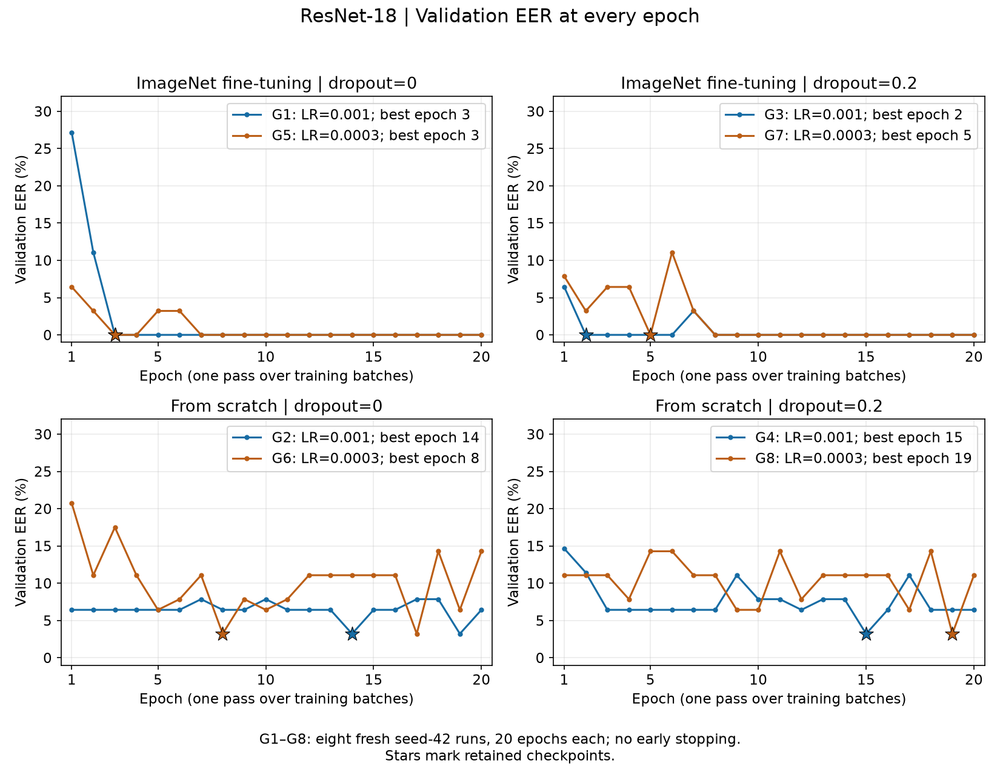
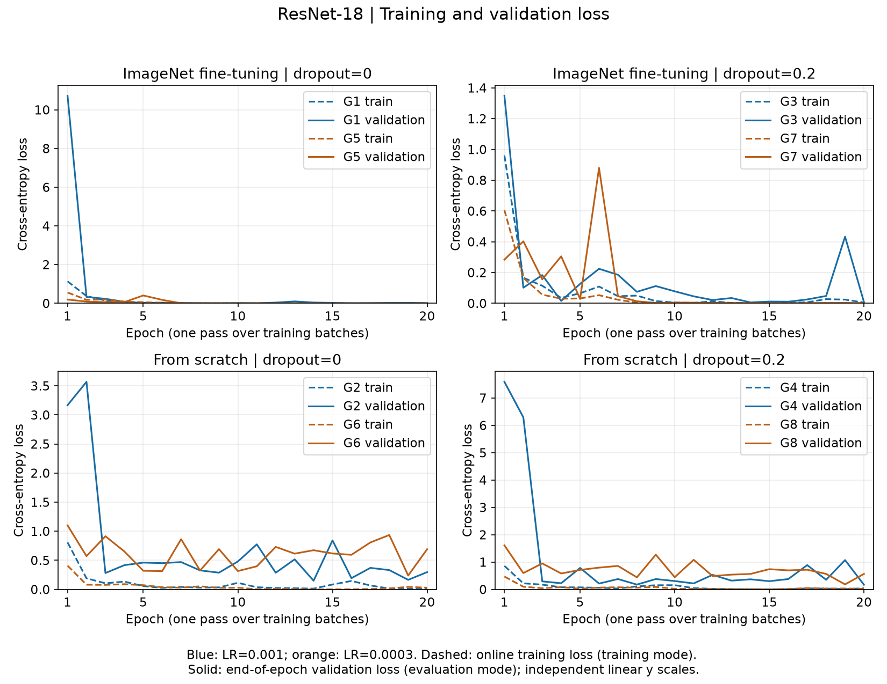

# ResNet-18 — Per-epoch experiment report

## Protocol

This report replaces the earlier five-run summary with **eight freshly trained variants
G1–G8**, following the grid in `notebooks/_template/architecture/experiments.ipynb`.
A separate fresh run **R0** rechecks the original configuration; R0 is not in the figures.

- Data: `training_dataset_v2`, **513 train / 63 validation / 63 test** clips.
  Validation and test each contain 28 allowed and 35 not-allowed clips.
- Grid: LR **0.001 / 0.0003** × dropout **0 / 0.2** × **ImageNet / from scratch**.
- Template defaults: Adam, batch 32, weight decay 0, seed 42, no scheduler.
  Every grid run completes **20 epochs without early stopping**; the full network is trained.
- Input: 3-second clips, 16 kHz, 80 log-mel bins, FFT 512, hop 160, per-sample normalization.
  Hardware: AMD Radeon 8060S / ROCm. Augmentation is not active in the shared loader.
- The shared `fit()` retains the first checkpoint attaining the lowest validation EER.
  Across variants, selection uses validation EER, then checkpoint validation loss, then run ID.
  Test metrics never participate in selection. The test set has already been inspected;
  the following test results are exploratory, not an untouched final benchmark.

## Read the figures

Each panel fixes initialization and dropout; each line is an identified run with a different LR.
Both figures show **all 20 epochs of G1–G8**, rather than a single selected run or a bar of minima.



Markers show individual epochs; stars identify retained checkpoints. The EER axis is in percent
and has the same scale in every panel. Overlapping lines mean equal EER, not equal predictions.
The exact run mapping and best checkpoints are:

- ImageNet, dropout 0: **G1** LR 0.001, epoch 3, EER 0%; **G5** LR 0.0003, epoch 3, EER 0%.
- ImageNet, dropout 0.2: **G3** LR 0.001, epoch 2, EER 0%; **G7** LR 0.0003, epoch 5, EER 0%.
- From scratch, dropout 0: **G2** LR 0.001, epoch 14, EER 3.21%; **G6** LR 0.0003, epoch 8, EER 3.21%.
- From scratch, dropout 0.2: **G4** LR 0.001, epoch 15, EER 3.21%; **G8** LR 0.0003, epoch 19, EER 3.21%.



Blue means LR 0.001; orange means LR 0.0003. Dashed lines are online training loss;
solid lines are end-of-epoch validation loss. Loss panels use independent linear y scales.
Training loss is measured while weights change, in training mode; validation uses evaluation
mode. These are not two evaluations of an identical frozen model. Large early validation-loss
spikes remain visible. From-scratch runs approach zero training loss while validation loss
stays higher and fluctuates, consistent with overfitting. This is a one-seed comparison;
it does not establish a reliable dropout or architecture advantage.

## Selected checkpoint: G7

G7 wins the validation-only rule: ImageNet, LR **0.0003**, dropout **0.2**, checkpoint **epoch 5**.
Its validation loss is **0.02818**. The validation-derived threshold **0.114268** is kept fixed
for the following FAR/FRR and accuracy values:

- **Train:** accuracy 99.80%, FAR 0.35% (1/284), FRR 0% (0/228).
  Evaluation contains 512 examples because the shared training loader drops its last partial batch.
- **Validation:** accuracy 100%, FAR 0% (0/35), FRR 0% (0/28), EER 0%.
- **Test:** accuracy **84.13%**, FAR **17.14% (6/35)**, FRR **14.29% (4/28)**.
  All six false accepts are T clips; all four false rejects are M clips.

EER 0% means the scores can perfectly separate this validation set at a suitable threshold.
It does **not** imply zero train/test errors. EER sweeps thresholds; the FAR/FRR above use one
fixed validation threshold. The shared EER is the nearest empirical ROC-point estimate,
not an interpolated estimate; exact ties between candidate points can be affected by rounding.

## Investigation of the earlier result

The earlier 0% was independently reproduced from its saved predictions and checkpoint.
Fresh recheck R0 also reaches validation EER 0%, at epoch 4 after 8 epochs of training,
with test FAR 20% and FRR 3.57%. R0 uses the original AdamW, LR 0.0002, batch 16,
dropout 0.2, weight decay 0.05 and patience 4. GPU training is not deterministic by default;
R0 does not exactly reproduce the earlier checkpoint or test numbers.

The data/prediction audit found no cross-split recording-ID overlap, exact duplicate PCM
across splits, or inconsistent saved metric counts. T is labeled **not allowed (0)** throughout.
However, T's 7 validation clips come from **one source recording**; its 7 test clips come from
two, and its 57 training clips come from ten. Exact hashes do not rule out near-duplicates
or shared sessions. The documented phone/codec/source differences remain a channel-confound
risk. The validation/test gap is real; its cause is not established by these checks.

Michal's published ConvNeXt report used **456/56/56 clips and training from scratch**.
This report uses 513/63/63 clips and explicitly compares both initializations; the published
numbers are not a controlled architecture comparison. Before more tuning, improve recording-
and session-level coverage and reserve a fresh holdout. More epochs alone did not fix the gap.

## Reproduce and storage

From the repository root:

```bash
uv sync --group dev
uv run iml-data validate data/training_dataset_v2
uv run python analyze_resnet18.py --train
```

The first call trains missing R0 and G1–G8 runs; later calls reuse only matching finished runs.
Omit `--train` to regenerate both figures and re-audit saved predictions. The script independently
checks confusion counts and empirical ROC candidates on train/validation/test and refuses data
changes. Dataset SHA1: `10ac1fb033e3b1845bc52ea2e2229c2982ad11f0`.

Histories, configs, audit receipts, predictions and weights stay under `runs/petr/resnet18_review*/`
on Coder, outside Git. Only this README, two selected figures and the script are published.
MLflow logging follows the template's quality-metrics-only rule; the server was unreachable
for this execution, so these runs were **not tracked in MLflow**. No tracking success is claimed.
