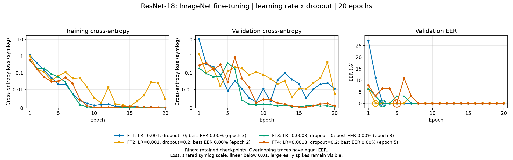
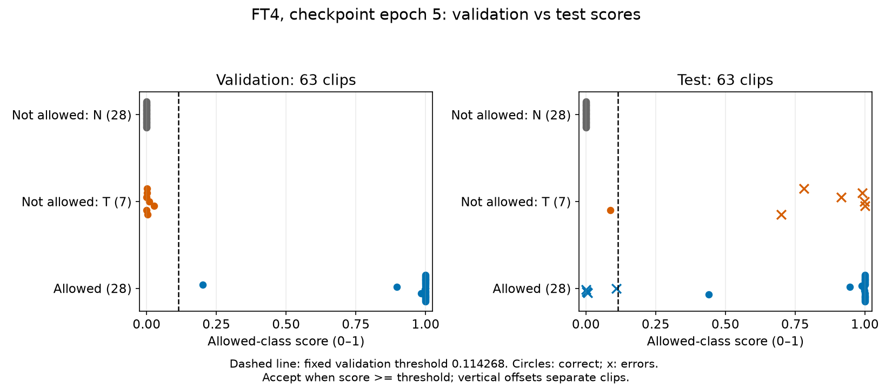

# ResNet-18 — ImageNet fine-tuning

## Setup and run IDs

This report compares **four fine-tuning runs**, FT1–FT4. Every run loads ImageNet weights
and trains the full ResNet-18, including a new two-class head. This experiment does not train
from scratch. The four runs already completed 20 epochs; this plotting revision adds no training.
Their former IDs were G1, G3, G5 and G7, respectively; the retained checkpoints are unchanged.

- Dataset: `training_dataset_v2`, **513 train / 63 validation / 63 test** clips.
  Validation and test each contain 28 allowed and 35 not-allowed clips.
- Input: 3 seconds, 16 kHz, 80 log-mel bins, FFT 512, hop 160, per-sample normalization.
- Fixed settings: Adam, batch 32, weight decay 0, seed 42, no scheduler, no early stopping.
  All four runs train for 20 epochs on an AMD Radeon 8060S / ROCm. No augmentation is active.
- **FT1:** LR 0.001, dropout 0; retained epoch 3, validation EER 0%.
- **FT2:** LR 0.001, dropout 0.2; retained epoch 2, validation EER 0%.
- **FT3:** LR 0.0003, dropout 0; retained epoch 3, validation EER 0%.
- **FT4:** LR 0.0003, dropout 0.2; retained epoch 5, validation EER 0%.

Initialization is delegated to `src/iml/models/__init__.py`: the ImageNet backbone is preserved,
its RGB stem is folded to one channel, and the new two-class Linear head uses He/Kaiming-normal
initialization (`fan_in`, ReLU), with zero bias. No layers are frozen. This is called by the
shared `fit()` loop; the script does not implement another model or training algorithm.

## Learning curves



The layout follows Artem's architecture report: **one panel per metric**, consistent run colors
and markers, one bottom legend, and rings marking retained checkpoints. Every line is one run;
its 20 points are epochs, not 20 independent runs. Both loss panels share one symlog y scale: linear below 0.01, logarithmic above. This keeps
large early spikes and small later losses visible without removing zero values.
Training loss is measured during weight updates; validation loss uses the end-of-epoch model
in evaluation mode. Overlapping EER lines mean equal EER values, not identical predictions.

ImageNet fine-tuning separates this validation set quickly. Zero EER persists across many
epochs, rather than appearing at only one isolated lucky checkpoint. This does not establish
reliable generalization or a dropout advantage: each setting has only one seed.

## Selected checkpoint and score separation

The shared loop retains the **first** epoch attaining the lowest validation EER. Across runs,
selection uses validation EER, then checkpoint validation loss, then run ID. This selects **FT4,
epoch 5**, with validation loss **0.02818**. The validation-derived threshold is **0.114268**.
The following FAR/FRR and accuracy values all use that same fixed threshold:

- **Train:** accuracy 99.80%, FAR 0.35% (1/284), FRR 0% (0/228).
  The shared training loader drops its last partial batch, so this evaluation contains 512 clips.
- **Validation:** accuracy 100%, FAR 0% (0/35), FRR 0% (0/28), EER 0%.
- **Test:** accuracy **84.13%**, FAR **17.14% (6/35)**, FRR **14.29% (4/28)**.
  All six false accepts are T clips; all four false rejects are M clips.



On validation, the largest not-allowed score is **0.02688** and the smallest allowed score is
**0.20166**: a threshold between them separates every clip. This is why validation EER is zero.
On test, class scores overlap. EER sweeps thresholds separately within a split; it is not the
error rate on all datasets. The shared EER uses a nearest empirical ROC-point estimate; tied
candidate points can be affected by floating-point rounding, but independent interpolation
also confirms the zero validation EERs.

## Why validation may look too optimistic

**Confirmed checks:** the saved metrics agree with independently recomputed confusion counts
and ROC candidates. No cross-split recording-ID overlap or exact PCM duplicates were found.
A further normalized waveform-correlation check of 4,572 same-speaker cross-split clip pairs
found no correlation >= 0.98 over an overlap of at least one second, allowing time shifts.
This check does not exclude all related sessions, re-encodings or other hidden dependencies.
Before any fine-tuning, the ImageNet model with its new random head had validation EER **31.79%**
at seed 42; the observed zero is not evidence that the classifier needed no training.

**Limited recording coverage:** T is labeled not allowed (0). Its 7 validation clips come from
**one** source recording, versus 10 train recordings and 2 test recordings. The full validation
set contains **63 clips**, not seven. Several clips from one recording do not provide the same
coverage of devices, rooms and sessions as independent recordings. Documented phone/codec/source
differences could also let the model exploit the recording channel rather than stable voice cues;
we have not established that this is the cause of the errors.

**Model-selection optimism:** validation does not contribute gradients, but it selects epochs,
hyperparameters and the decision threshold. Repeatedly choosing the best result on the same finite
validation set can favor an accidentally optimistic estimate; this is overfitting through model
selection, not proof that train files entered validation ([Cawley and Talbot, 2010](https://www.jmlr.org/papers/v11/cawley10a.html)).
It is a plausible contributor, not a diagnosed cause here. Persistent zero EER across many epochs
means the result cannot be explained solely as one lucky checkpoint. The validation/test gap may
combine limited coverage, channel differences, training overfitting and selection optimism.

**Comparison with Michal:** his published ConvNeXt report used 456/56/56 clips and training from
scratch. These are different experimental conditions, so its nonzero EER does not establish a
ResNet-specific bug or make either architecture better. More recent matched runs would need
matching dataset fingerprints and configs before comparison.

The next evaluation should cover independent recording sessions/devices for T and the allowed
speakers and reserve a fresh holdout. Do not randomly distribute neighboring excerpts from one
recording across splits. The current test set has already been inspected; it is exploratory and
cannot serve as an untouched final benchmark. These results do not establish deployment readiness.

## Reproduce

```bash
uv sync --group dev
uv run iml-data validate data/training_dataset_v2
uv run python analyze_resnet18.py --train
```

Only missing ImageNet fine-tuning variants are trained; matching finished runs are reused.
Omit `--train` to audit existing predictions and regenerate the two figures without training.
Dataset SHA1: `10ac1fb033e3b1845bc52ea2e2229c2982ad11f0`.
Configs, histories, audit receipts, predictions and weights stay in `runs/petr/resnet18_review*/`
on Coder, outside Git. MLflow receives quality metrics only when reachable; it was unreachable
for these runs, so they were not tracked there. The selected ONNX export matches PyTorch
(max absolute output difference 2.38e-6). Only this README, the two figures and the script are published.
